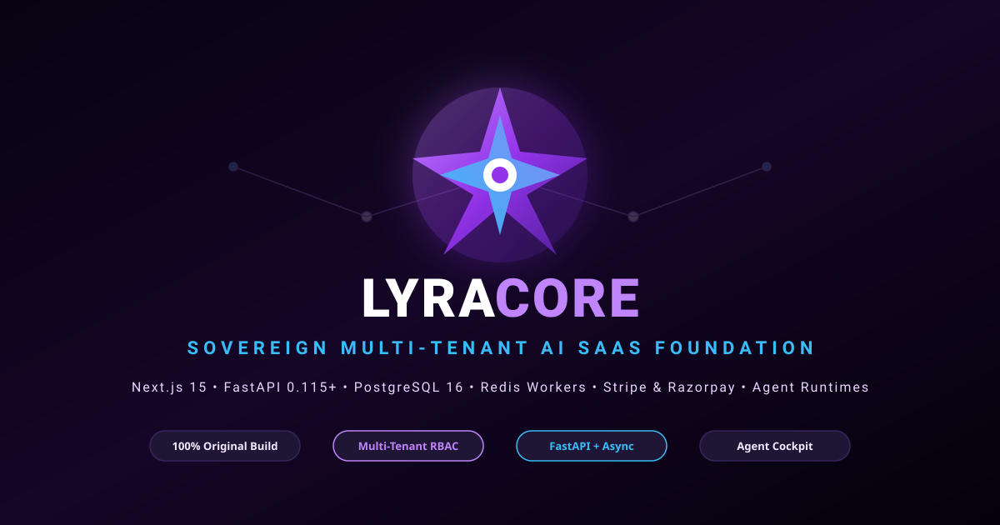

<p align="center">
  <picture>
    <source media="(prefers-color-scheme: dark)" srcset="public/brand/lyra-banner.svg">
    <source media="(prefers-color-scheme: light)" srcset="public/brand/lyra-banner.svg">
    
  </picture>
</p>

<p align="center">
  <a href="https://github.com/wtfear/LyraCore/actions/workflows/ci.yml">
    
  </a>
  <a href="https://opensource.org/licenses/MIT">
    
  </a>
  <a href="https://fastapi.tiangolo.com">
    
  </a>
  <a href="https://nextjs.org">
    
  </a>
  <a href="https://docker.com">
    
  </a>
</p>

<h1 align="center">LyraCore</h1>

<p align="center">
  <strong>Sovereign Multi-Tenant AI SaaS Foundation &amp; Autonomous Agent Runtime</strong><br>
  <em>100% Original Custom Build Engineered by WTFear Agency (Zero Forks, Zero Upstream Traps)</em>
</p>

---

## 🏛️ Executive Summary

**LyraCore** is an institutional-grade, original multi-tenant AI SaaS foundation built from the ground up by the **WTFear Agency** engineering team. It solves the critical **CTO credibility barrier** in high-value enterprise sales by demonstrating sovereign engineering mastery rather than reliance on third-party forks.

Engineered with **Next.js 15 (React 19)** on the frontend and an asynchronous **FastAPI 0.115+ (Python 3.12)** microservices core, LyraCore combines schema-isolated multi-tenancy, granular Role-Based Access Control (RBAC), multi-gateway billing webhooks (Stripe & Razorpay), and an asynchronous AI agent execution runtime backed by Redis workers.

### The Agency Commercial Advantage ($50k – $150k+ Custom Builds)
* **100% Original Architecture:** Written from scratch with zero third-party framework entanglements or restrictive licenses.
* **Turnkey Multi-Tenancy:** Schema and tenant ID boundary enforcement prevents cross-tenant data leakage in regulated banking and healthcare environments.
* **Autonomous Agent Runtime:** Extensible LangGraph-compatible decision pipeline dispatches asynchronous agent workflows across worker pools.
* **Sovereign Monetization Engine:** Built-in webhook listeners for Stripe (Global) and Razorpay (India/APAC) recurring client retainers.

---

## ⚡ Architecture & Subsystem Layout

```
                       ┌───────────────────────────────┐
                       │     NEXT.JS 15 FRONTEND       │
                       │     (React 19 + Tailwind)     │
                       └──────────────┬────────────────┘
                                      │ REST / JSON API
                                      ▼
                       ┌───────────────────────────────┐
                       │       FASTAPI BACKEND         │
                       │  (Pydantic v2 + SQLAlchemy)   │
                       └──────────────┬────────────────┘
                                      │
       ┌──────────────────┬───────────┴───────────┬──────────────────┐
       ▼                  ▼                       ▼                  ▼
┌──────────────┐   ┌──────────────┐        ┌──────────────┐   ┌──────────────┐
│ MULTI-TENANT │   │ AGENT RUNTIME│        │ BILLING HOOKS│   │ REDIS QUEUE  │
│ • Tenant Org │   │ • LangGraph  │        │ • Stripe     │   │ • Background │
│ • User RBAC  │   │ • Tool Loops │        │ • Razorpay   │   │ • Ephemeral  │
│ • Isolation  │   │ • Token Logs │        │ • Subscriptions│ • Cache     │
└──────────────┘   └──────────────┘        └──────────────┘   └──────────────┘
```

---

## 🚀 Quick Start (Docker Compose)

Deploy the entire LyraCore stack (FastAPI Backend, Next.js Frontend, PostgreSQL 16, and Redis) with a single command:

```bash
# 1. Clone repository
git clone https://github.com/wtfear/LyraCore.git
cd LyraCore

# 2. Configure environment
cp .env.example .env

# 3. Launch stack
docker compose up -d
```

### Access Ports & Services
* **Frontend Web App:** [http://localhost:3000](http://localhost:3000)
* **Backend API Docs (Swagger):** [http://localhost:8000/api/v1/docs](http://localhost:8000/api/v1/docs)
* **Health Endpoint:** [http://localhost:8000/health](http://localhost:8000/health)

---

## 🔒 Security & Compliance

* **Data Isolation:** All database transactions enforce active tenant boundary filters.
* **JWT Authentication:** Cryptographically signed HS256 tokens with Bcrypt password hashing.
* **Air-Gapped Friendly:** Runs completely offline inside sovereign private VPCs with zero external call-homes.

---

## 📜 License

LyraCore is original open-source software released under the **[MIT License](LICENSE)** by WTFear Agency.
